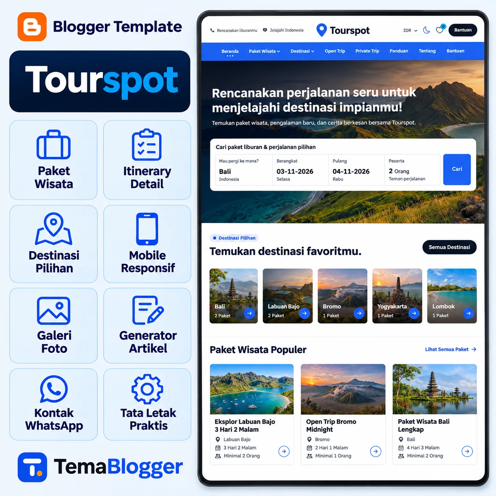

# Tourspot – Template Blogger Tour & Travel Indonesia — Free

Template Blogger tour dan travel Indonesia. Edisi Free untuk mencoba tampilan dan pengelolaan konten melalui Blogger.

> Pratinjau produk Tourspot. Gambar katalog memperlihatkan fitur produk lengkap; versi Free memiliki pembatasan iklan dan kredit footer. Rincian fitur Free tercantum di README.

## Unduh dan demo

- [Unduh Tourspot Free v1.5.7](Tourspot-v1.5.7-Free.xml) — buka file, lalu pilih **Raw / Download raw file**.
- [Lihat demo produk](https://tourspot-temablogger.blogspot.com/) (demo produk lengkap, bukan demo pembatasan Free).
- [Beli Tourspot Premium](https://www.temablogger.com/2026/11/tourspot-template-blogger-tour-travel-indonesia.html)
- [Dashboard pelanggan Tema Blogger](https://www.temablogger.com/p/client-area.html#licenses)

## Dukung developer

Jika tema ini bermanfaat, beri ⭐ Star pada [repositori ini](https://github.com/tema-blogger/tourspot-template-blogger-tour-travel-indonesia-free) dan bagikan tautannya kepada pengguna Blogger lain. Dukungan Anda membantu pengembangan tema gratis. Terima kasih sudah menghargai karya developer; semoga bermanfaat dan membawa berkah.

## Fitur tampilan

- Katalog paket wisata
- Itinerary
- Galeri foto
- Generator postingan

## Batasan Free

- Tidak memerlukan kode lisensi berbayar untuk menjalankan edisi Free.
- Slot iklan bawaan dikunci dan tidak menayangkan kode iklan pada edisi Free.
- Kredit footer tetap: **© 2026 Template Blogger SEO Friendly By Tema Blogger. All rights reserved.** Tautan Tema Blogger menuju **https://www.temablogger.com/**.
- Pengaturan konten, logo, menu, warna dan gadget selain bagian terkunci tetap mengikuti kemampuan masing-masing tema.
- Untuk membuka pengaturan iklan dan kredit yang tersedia pada produk, beli dan aktifkan versi Premium.
- Jika kredit footer atau kode inti edisi Free berubah, kredit dipulihkan dan muncul pemberitahuan dengan tombol menuju https://www.temablogger.com/. Pengaturan melalui Tata Letak tetap dapat digunakan.

## Pemasangan

1. Unduh file XML Free di atas.
2. Di Blogger buka **Tema → menu panah → Cadangkan** terlebih dahulu. Simpan juga salinan pengaturan gadget penting.
3. Pilih **Pulihkan**, lalu unggah XML Free.
4. Atur konten melalui **Tata Letak** dan pengaturan tema yang tersedia.

## Upgrade dan update tanpa menimpa pengaturan

Cadangkan XML yang sedang terpasang melalui Blogger. Setelah membeli Premium dan menambahkan domain di dashboard pelanggan, gunakan fitur **pembaruan XML yang sudah dipakai** pada kartu lisensi. Unggah cadangan XML milik Anda agar pengaturan gadget dipertahankan; lalu pasang file hasil pembaruan. Hindari menimpa situs yang sudah dikustom dengan file demo baru.

Penggabungan Free → Premium diperiksa pada berkas XML lokal untuk 16 produk: identitas gadget dan isi `widget-settings` dipertahankan. Penyimpanan ulang melalui editor Blogger dan integrasi pihak ketiga tetap perlu diperiksa setelah pemasangan. Perubahan manual pada kode renderer yang dikunci dapat membuat penggabungan otomatis ditolak; simpan cadangan XML asli.

## Versi dan kredit aset

Edisi Free **1.5.7**, berdasarkan mesin tema Premium **1.5.5**. Ini kanal distribusi terpisah; paket pelanggan Premium tidak diganti.

Ikon Material Design Icons berasal dari [Pictogrammers](https://pictogrammers.com/library/mdi/), dengan lisensi Apache 2.0 untuk aset ikon. Lihat `PICTOGRAMMERS-NOTICE.txt` dan `LICENSE-APACHE-2.0.txt`. Lisensi ikon tidak mengubah ketentuan tema.

## Penggunaan edisi Free

Anda boleh memasang edisi Free pada blog Anda dengan mempertahankan kredit dan batasan Free. Paket ini tidak menyertakan lisensi Premium, kode aktivasi, data pelanggan, atau sumber pengembangan pribadi.

© 2026 [Tema Blogger](https://www.temablogger.com/). All rights reserved.
